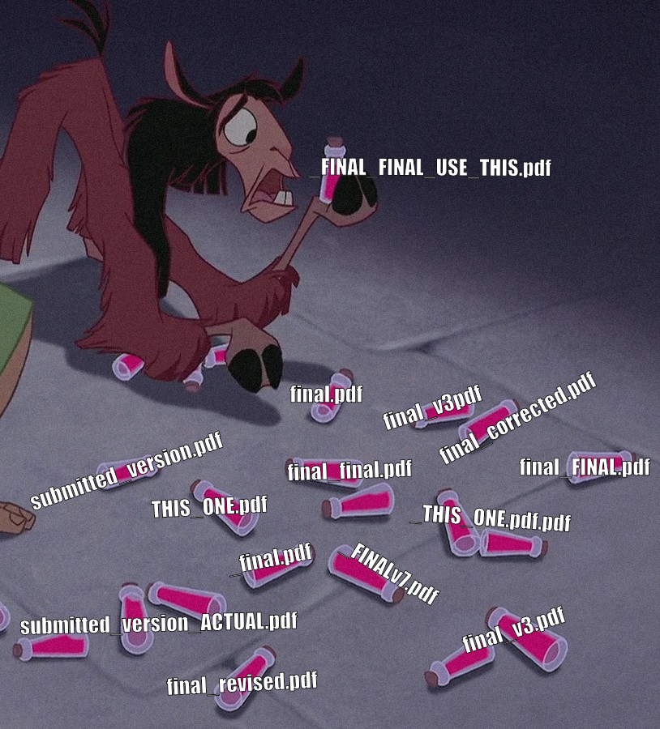

<p align="center">
  
</p>

<div align="center">
  <h3>Press</h3>
  <p><i>Open a LaTeX or Markdown source file. Press compiles and displays it.<br />
  Built with Rust.</i></p>
  <p>
    
    
    
  </p>
</div>

<p align="center">
  
</p>

#

### Contents

- [Installation](#installation)
- [Opening a document](#opening-a-document)
- [Starting a document](#starting-a-document)
- [Editing](#editing)
  - [Neovim](#neovim)
- [Versions](#versions)
- [Markdown](#markdown)
- [Keys](#keys)
- [Settings](#settings)
- [Requirements](#requirements)
- [License](#license)

Press is a macOS viewer for LaTeX and Markdown source files. Open a source file and Press compiles
it, displays the result, and rebuilds it whenever you save.

- **Automatic rebuilds.** Press watches the source and updates the view after each save. You do not
  need `latexmk -pvc`, a watcher script, or a reload command.
- **No generated files in the project.** Press keeps compiled PDFs and auxiliary files in its own
  cache. [Creating a document](#starting-a-document) from a template is the only operation that
  writes to your project folder.
- **Titled snapshots.** Press can store selected versions of the source and compile any of them for
  viewing. Press history is separate from Git and your editor's undo history.

## Installation

Press is not distributed as a prebuilt download. After cloning the repository, build and install
it with:

```sh
npm install
npm run install:app
```

These commands install `Press.app` in `/Applications`. Run them again to upgrade. The first build
takes longer because it compiles the PDF renderer's C code.

To add a `press` command to your terminal, run:

```sh
npm run install:app -- --link
```

This writes a small script to `~/.local/bin/press`, so you can run `press paper.tex` from any
directory. Use the flag once.

To remove Press:

```sh
npm run uninstall:app            # the app
npm run uninstall:app -- --purge # the app and every version it stored
```

Without `--purge`, Press keeps your document history. Its storage contains the only copy of those
snapshots, so purge it only when you no longer need them.

## Opening a document

You can open a document in any of three ways:

- **Drag** a `.tex` or `.md` file onto the Press window, or use the Add button.
- **`press paper.tex`** from the terminal, if you linked the command.
- **`:Press`** from Neovim.

Give Press a file and it opens the corresponding document. Give it a folder and it lists the
documents it finds, with recently used documents first.

You can open a document from any file that belongs to it. For example, running `:Press` while
editing `chapters/three.tex` opens the full thesis. Press follows `% !TEX root` directives and the
`\input` graph to find the document root. If a folder contains two papers, Press treats them as
separate projects, with separate builds and histories.

You only need to add a document once. Press keeps it in the library after that.

## Starting a document

**New document** opens your template gallery. Choose a template, name the document, and select a
folder. Press creates the files there and opens the document.

Press ships without templates. To create one, right-click a document in the library and choose
**Save as template**. You can save only the main file or select files from the document tree. Press
excludes build output, editor scratch files, `.git`, and unrelated documents. The main file is
always included.

A template is a copy. Later changes to the original project do not affect it, and Press does not
alter the source while saving or restoring it. Save an empty document if you want an empty
template. Press also stores the last compiled page for the gallery card and remembers the TeX
engine.

A single-file template creates one file in the selected folder. A multi-file template creates a
folder named after the new document. Press refuses to overwrite an existing file or folder.

Template creation is the only feature that writes source files. Builds, snapshots, and auxiliary
files stay in Press's storage.

## Editing

Press is a viewer, not an editor. The **Editor** button runs the command you choose in Settings.
Use `{file}` as a placeholder for the document and `{dir}` for its folder. If you leave the command
unset, Press opens the file with the system's default application.

Press watches files directly, so it works with Vim, VS Code, Emacs, TextEdit, and background
scripts without a plugin or save hook. After a change, it rebuilds the document and updates the
page in place while preserving your scroll position.

Click a reference, citation, or link in the PDF to follow it. `⌘click` anywhere in the PDF to see
the source for that location, including the file, line number, and copyable text. This also works
for saved versions whose source is no longer on disk.

### Neovim

[press.nvim](https://github.com/antonio-leitao/press.nvim) adds a `:Press` command to Neovim. It
sends the current file path to Press, which finds and opens the document root. The plugin locates
the installed app automatically and does not require `--link` or configuration.

The plugin only opens documents. Press handles compilation, file watching, and reloading.

## Versions

Use `⌘K` to save and title a snapshot of the current document. Press never creates snapshots
automatically.

The sidebar pins the working copy at the top, followed by each saved version, its age, and its
build status. Select a version to read it just like the working copy. If Press has not compiled it
before, it does so in the background. Press builds versions from temporary copies and writes
nothing to your project folder.

Git still handles branches, merges, and remotes. Press history is a flat list of document versions
stored outside the project. Press deduplicates identical content, so snapshots that use the same
figures store one copy of each figure.

Press stores only the files that belong to the document: its source, figures, `.bib` files, and
included chapters. It excludes build output, editor scratch files, `.git`, and unrelated documents
in the same folder.

## Markdown

A Markdown file uses the same viewer, file watching, and history as a LaTeX file. Press runs it
through pandoc and then latexmk.

Set `geometry`, `documentclass`, `fontsize`, and `header-includes` in the document's YAML
frontmatter. Press passes those values to pandoc without adding its own formatting.

One limitation: Markdown build errors identify the file but not the source line. Line numbers in
the build log refer to the LaTeX generated by pandoc, not to the original Markdown, so Press does
not display a potentially misleading line number.

## Keys

The viewer uses [zathura](https://pwmt.org/projects/zathura/)'s keymap and supports numeric counts.
For example, `12G` goes to page 12, and `3j` scrolls down three steps.

| Key                 | Action                                       |
| ------------------- | -------------------------------------------- |
| `j` / `k`           | scroll down / up                             |
| `h` / `l`           | scroll left / right                          |
| `d` / `u`           | scroll half a page down / up                 |
| `f` / `b` / `space` | move one page down / up                      |
| `J` / `K`           | go to the next / previous page               |
| `gg` / `G`          | go to the first / last page                  |
| `12G`               | go to page 12                                |
| `⌃o` / `⌃i`         | go back / forward after a jump               |
| `+` / `-`           | zoom in / out                                |
| `0`                 | use the actual page size                     |
| `a` / `s`           | fit the page / page width                    |
| `⌃r`                | toggle dark mode for the page and interface  |
| click               | follow a reference, citation, or link        |
| `⌘click`            | show the source for that location in the PDF |
| `R`                 | rebuild the selected version                 |
| `⌘K`                | save a snapshot of the working copy          |
| `?`                 | show this key list in the app                |

## Requirements

- macOS
- A TeX distribution with `latexmk` (MacTeX, TeX Live, BasicTeX)
- pandoc, for Markdown documents only
- Node.js and Rust, to build Press

Press does not enable `--shell-escape`. It does warn you when a document's folder contains a
`.latexmkrc`, which latexmk executes as Perl. Only open documents from folders you trust.

## License

Copyright (C) 2026 Antonio Leitao. GNU Affero General Public License, version 3.
The full text is in
[LICENSE](LICENSE).

Press uses MuPDF, which is licensed under AGPL-3.0, and compiles its C code into the application.
As a result, Press must be distributed under the same license.
